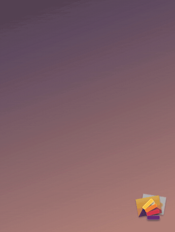

<p align="center">
  
</p>

<h1 align="center">Stash</h1>

<p align="center">A download manager and macOS-style Downloads stack for Windows.</p>

<p align="center">
  <a href="../../releases/latest"></a>
  <a href="../../actions/workflows/ci.yml"></a>
  
</p>

<p align="center">
  
</p>

---

Stash shows your newest downloads as a small pile in the corner of the screen. Hover over the pile and the files fan out above it with their names, the way a Dock stack does on a Mac. Click a file to open it, or drag it into another app.

Stash is also a full download manager. Downloads you start pop into the stack and show their progress and speed right there, and the Downloads window lists, pauses, resumes and sorts them. It downloads web links over several connections at once, and downloads torrents and magnet links too.

Stash is a single exe written in Rust. The Windows compositor runs its animations, so they play at full frame rate while Stash itself does no work.

## What it does

- Shows the three newest files as a pile, using real thumbnails for photos, videos and documents.
- Fans out on hover. The folder you're viewing sits at the bottom of the fan, and clicking it opens the folder in Explorer.
- Opens a file on click and lets you drag it into any app. Right-click a file to show it in Explorer or move it to the Recycle Bin.
- Watches more than one folder. Add Screenshots, Desktop or any other folder, then scroll over the stack to switch between them.
- Bounces when a new file arrives, even in a folder you aren't viewing.
- Moves files you drop onto it into the folder you're viewing.
- Opens on top of your windows when you click its tray icon, and goes back behind them when it closes.
- Lets you choose the sort order, how many files to show, the icon size, the corner, and whether it starts when you sign in.

### Downloads

- Downloads web links over up to 16 connections at once. When one connection finishes its part, it takes over half of the slowest one's.
- Pauses and resumes downloads, even after you quit Stash or restart your PC, as long as the server supports it.
- Downloads torrents from magnet links and .torrent files, and can keep seeding them after they finish.
- Runs a few downloads at a time and queues the rest. Set each download's priority to High, Normal or Low, or start one right away.
- Limits the total download speed, if you like.
- Retries when the connection drops or a server is busy.
- Shows a new download popping into the stack, with its progress and speed on the stack and in the fan.
- Keeps your download history, grouped by day. Every past download keeps its link: right-click to copy it, open the page it came from, or download it again. If a file was moved or deleted, Stash says so and offers to download it again.
- Searches your downloads loosely, so typos and initials still find them ("bbb" finds Big Buck Bunny), and narrows the search with filters like `type:video`, `site:github.com`, `is:missing`, `>100mb` or `today`. Filters complete as you type.
- Takes downloads from Chrome, Edge, Brave and Firefox with the [browser extension](browser/README.md), including ones that need you to be signed in.
- Opens magnet links and .torrent files, if you turn that on in Settings.

## Install

The easiest way is the Microsoft Store: [Stash: Downloads stack](https://apps.microsoft.com/detail/9PMVDZ3LZ490). The Store version updates itself and runs natively on both x64 and Arm PCs.

To install from GitHub instead:

1. Download `Stash-Setup-<version>.exe` from the [latest release](../../releases/latest).
2. Run it. It installs for your account only, so it doesn't ask for admin rights. It can also start Stash when you sign in.

Each release also has portable exes that run without installing: `Stash-<version>-portable.exe` for x64 PCs and `Stash-<version>-arm64-portable.exe` for Arm PCs.

The GitHub installer isn't code-signed, so Windows SmartScreen may warn you about it. Select **More info**, then **Run anyway**. The Store version doesn't show this warning, because Microsoft signs it.

To uninstall, open Settings, go to Apps, then Installed apps. Stash keeps your settings in `%APPDATA%\Stash`.

Stash needs Windows 10 version 1903 or later, or Windows 11.

### Updates

The Store version updates itself through the Microsoft Store. The installer and portable versions check GitHub for a new release once a day and download it in the background. When it's ready, a card above Settings in the Stash window (and an item at the top of the tray menu) offers **Restart to Update**. Stash only installs a download whose SHA-256 hash matches the release's `SHA256SUMS.txt`. Turn automatic downloads off, or check by hand, in **Settings**, under **About**.

### Keep the Stash icon on the taskbar

Windows hides new tray icons behind the arrow next to the clock. Move the Stash icon onto the taskbar so you can open the stack with one click from any app.

- Windows 11: open Settings, go to Personalization, then Taskbar, then Other system tray icons, and turn on Stash.
- Windows 10: open Settings, go to Personalization, then Taskbar, select "Select which icons appear on the taskbar", and turn on Stash.

You can also drag the icon out of the hidden-icons menu onto the taskbar.

## Using Stash

| To | Do this |
| --- | --- |
| Open the stack | Hover over it, click it, or click the tray icon |
| Open a file | Click it |
| Use a file in another app | Drag it out of the stack |
| Open the folder in Explorer | Click the folder at the bottom of the open stack |
| Switch folders | Scroll over the stack, or pick one under **Folders** in the right-click menu |
| Add or remove a folder | Right-click the stack or the tray icon and open **Folders** |
| Change settings | Right-click the stack or the tray icon |
| Open the Downloads window | Open Stash again from the Start menu, or choose **Show Downloads** from the tray icon's menu |
| Download a link | Copy it, then press Ctrl+V in the Downloads window. Or choose **New Download…** |
| Find a download | Press Ctrl+F (or just start typing) in the Downloads window. Tab completes filters, and ↑ ↓ or Ctrl+N / Ctrl+P move through the suggestions |
| Download a past file again | Hover over it and select the download-again button, or right-click it |
| Pause, resume or cancel | Use the buttons on a download, or right-click it |
| Change settings | Select **Settings** at the bottom of the Downloads window: folders in the stack, downloads at once, connections, speed limit, units, torrents, the browser extension, and the stack's corner and size |

## Build from source

You need [Rust](https://rustup.rs) (stable, MSVC toolchain) and the Windows SDK. The Visual Studio C++ build tools include the SDK.

```powershell
git clone https://github.com/frstycodes/stash.git
cd stash
cargo build --release
.\target\release\stash.exe
```

To build the installer, install [NSIS 3](https://nsis.sourceforge.io) with `winget install NSIS.NSIS` and run:

```powershell
.\installer\build.ps1
```

The script writes the installer to `dist\Stash-Setup-<version>.exe`.

### Debugging

Set these environment variables before starting `stash.exe`.

- `STASH_LOG=1` writes a log to `%TEMP%\stash.log`.
- `STASH_SLOW=5` plays every animation five times slower.
- `STASH_PIN_OPEN=1` keeps the stack open.
- `STASH_DEMO=<folder>;<folder>` shows those folders in place of yours, keeps the stack above every window, and saves no settings.
- `STASH_VIEW=settings`, `STASH_VIEW=settings:<pixels>` (scrolled down), `STASH_VIEW=settings/<text>` (searching settings) or `STASH_VIEW=search:<text>` opens the Stash window on that view, for screenshots.
- `STASH_DATA=<folder>` keeps the download list and torrent state there instead of `%APPDATA%\Stash`.
- `STASH_DEMO_SCRIPT="1.5:open;4:next;6:close"` plays a timed sequence in demo mode. Each step is a time in seconds after start and a command (`open`, `close`, `next` or `prev`). The demo GIF above was recorded this way.

## Releases

GitHub Actions builds and publishes every release.

- Every push and pull request runs [CI](.github/workflows/ci.yml), which builds the app, the installer and the Store bundle.
- Pushing a version tag such as `v0.3.0` runs [Release](.github/workflows/release.yml). It builds the installer, portable exes for x64 and Arm64, and a Store bundle with both architectures. It publishes them as a GitHub release with notes generated from the commits, then submits the bundle to the Microsoft Store as a new version.

To cut a release, run this from a clean `main` branch:

```powershell
.\installer\release.ps1 0.3.0
```

The script sets the version in `Cargo.toml`, commits, tags `v0.3.0` and pushes. The release appears on the [Releases page](../../releases) when the workflow finishes, usually within ten minutes. The Store update then goes through Microsoft's certification, which takes a few hours to three business days.

### Store publishing

The Store step needs four repository secrets from Partner Center. Until they exist, the workflow skips the Store step and still publishes the GitHub release.

| Secret | Where to find it |
| --- | --- |
| `STORE_SELLER_ID` | Partner Center, Account settings, Legal info (Seller ID) |
| `STORE_TENANT_ID` | Partner Center, Account settings, User management, Microsoft Entra applications |
| `STORE_CLIENT_ID` | Same page, after you create an Entra application with the Manager role |
| `STORE_CLIENT_SECRET` | Same application, under Keys (a new key) |

Add each one with `gh secret set <NAME>`, which asks for the value without echoing it.

The Store app's identity lives in [packaging/identity.json](packaging/identity.json), and `packaging/build-msix.ps1` builds the package.

## How it works

- Stash draws with Windows Composition (the Visual Layer). Each icon's position, tilt and size in the fan is an expression of one `Progress` value, and the compositor animates that value with a spring.
- Direct2D and DirectWrite draw the thumbnails, labels and folder badge.
- The Windows shell supplies thumbnails through `IShellItemImageFactory`, and runs drag-and-drop and file actions.
- The [`notify`](https://crates.io/crates/notify) crate watches folders with `ReadDirectoryChangesW`, so Stash never polls the disk.
- Downloads run on a small [tokio](https://tokio.rs) runtime on their own thread. Web downloads use [`reqwest`](https://crates.io/crates/reqwest) with the Windows TLS stack, and torrents use [`librqbit`](https://crates.io/crates/librqbit), which only starts when you add your first torrent. The engine wakes the UI only while something is downloading, at most twice a second.
- The Downloads window uses the same compositor approach as the stack, on a Mica backdrop. Progress bars glide between updates on the compositor, so a download moving along costs almost nothing to show.

## Privacy

Stash connects to the internet only for the downloads you start, and collects no data. See the [privacy policy](PRIVACY.md).

## License

Stash is source-available under the [PolyForm Noncommercial License 1.0.0](LICENSE.md).

You can read the code, use Stash, change it and share your changes, as long as you don't use it for a commercial purpose. Personal use, study, hobby projects, and use by charities, schools and public institutions are all allowed. For commercial use, [open an issue](https://github.com/frstycodes/stash/issues) to ask.

Copyright 2026 Sandesh Pandey.

The Downloads window's icons are from [Reicon](https://reicon.dev) (MIT license). Its typeface is [DM Sans](https://github.com/googlefonts/dm-fonts) (SIL Open Font License, see `assets/fonts/OFL.txt`), built into the exe.
